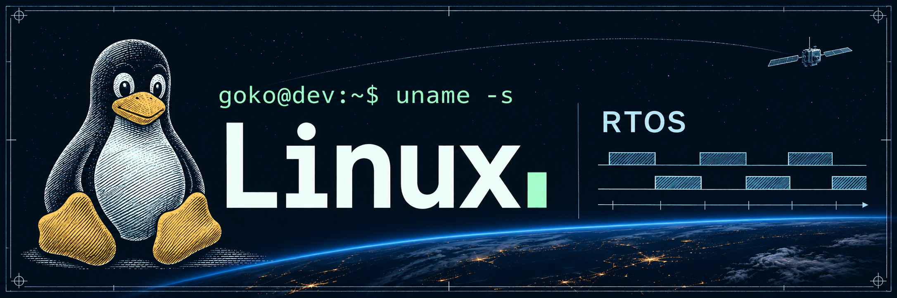

# GoKo

I read kernel code the way I read a schematic: pick a signal and follow it. In Linux or an RTOS, that might mean tracing an interrupt to the task it wakes. In flight software, I sometimes start with a timestamp and work back to the clock that produced it.

I especially enjoy bringing software up on a new board. A port makes you notice all the things the original code took for granted. I write down what I had to check for myself, especially the parts that looked obvious until I tried them.

[Field notes in Chinese](https://www.goku72.com/) · Norway

## Activity

<picture>
  <source media="(prefers-color-scheme: dark)" srcset="https://raw.githubusercontent.com/GoKo-Son626/GoKo-Son626/output/github-contribution-grid-snake-dark.svg" />
  
</picture>

[↻ Refresh the snake](https://github.com/GoKo-Son626/GoKo-Son626/actions/workflows/snake.yml) · Updated every four hours.

Tools and statistics

  
  
  
  
  

  
  

